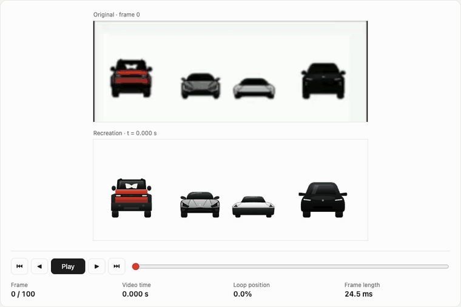

# car-progress

A car-themed progress indicator for React. Four cars pass a battery down the line: the red SUV drops it, the sports car lifts to let it through, the silver car backflips on steam jets, and the black SUV pulls it in.

The animation is drawn in SVG and moved with CSS keyframes. It has no runtime dependencies besides React.



*The recording shows the frame-compare tool used to build this component. The original clip (top) and `CarProgress` (bottom) run on one clock, one frame at a time. Played at half speed.*

## Install

```sh
npm install github:allen546/car-progress
```

The package builds itself on install (`prepare` script).

## Usage

```jsx
import CarProgress from 'car-progress';
import 'car-progress/style.css';

// Indeterminate: loops while you wait
<CarProgress />

// Determinate: 0–100
<CarProgress value={42} />

// Size, speed, and accessible label
<CarProgress size={200} duration={3} label="Uploading" />
```

## Props

| Prop | Type | Default | Description |
| --- | --- | --- | --- |
| `value` | `number` | — | Progress from 0 to 100. Leave it out for the indeterminate loop. |
| `size` | `number` | `288` | Width in pixels. The height follows the 288 × 106 aspect ratio. |
| `duration` | `number` | `2.475` | Length of one indeterminate loop, in seconds. |
| `motion` | `'smooth' \| 'stepped'` | `'smooth'` | `stepped` holds each pose like the original clip, at about 8 poses per second. |
| `time` | `number` | — | Freezes the indeterminate loop at this many seconds. Useful for tests and frame comparison. |
| `label` | `string` | `'Loading'` | Accessible name for the `progressbar` role. |
| `className`, `style` | — | — | Passed to the wrapper element. |

## Modes

**Indeterminate.** Without `value`, the cars play the full loop. The poses were measured from each frame of the original clip, so the timing and positions match it.

**Determinate.** With `value`, the battery travels along a road to the given percentage. Each car reacts when the battery passes under it, and the black SUV bounces at 100%.

## Accessibility

- The wrapper has `role="progressbar"`. In determinate mode it also has `aria-valuenow`, `aria-valuemin` and `aria-valuemax`.
- With `prefers-reduced-motion: reduce`, the car movement stops. The battery still shows progress.

## Development

```sh
npm install
npm run build   # dist/car-progress.js, .cjs and .css
```

## License

MIT
